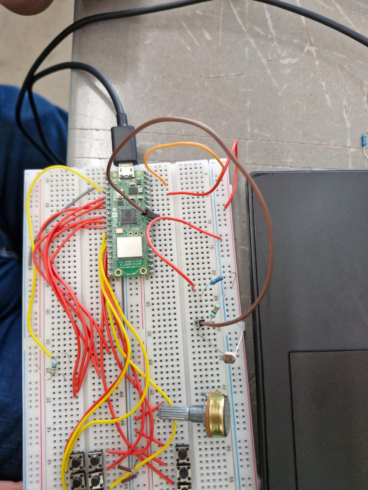
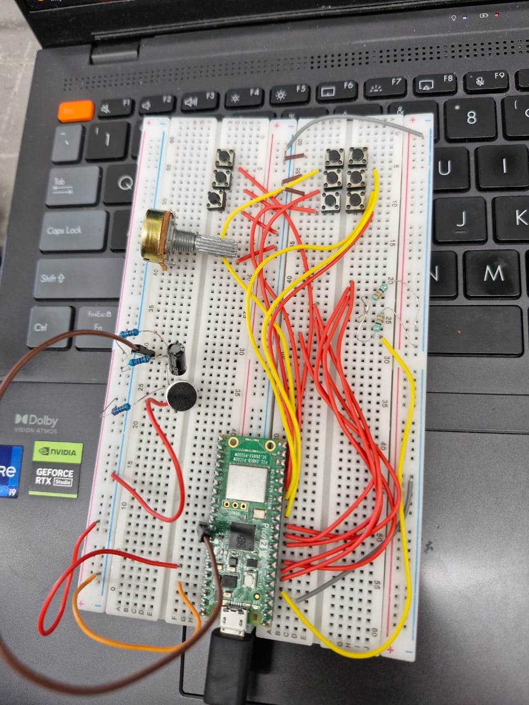
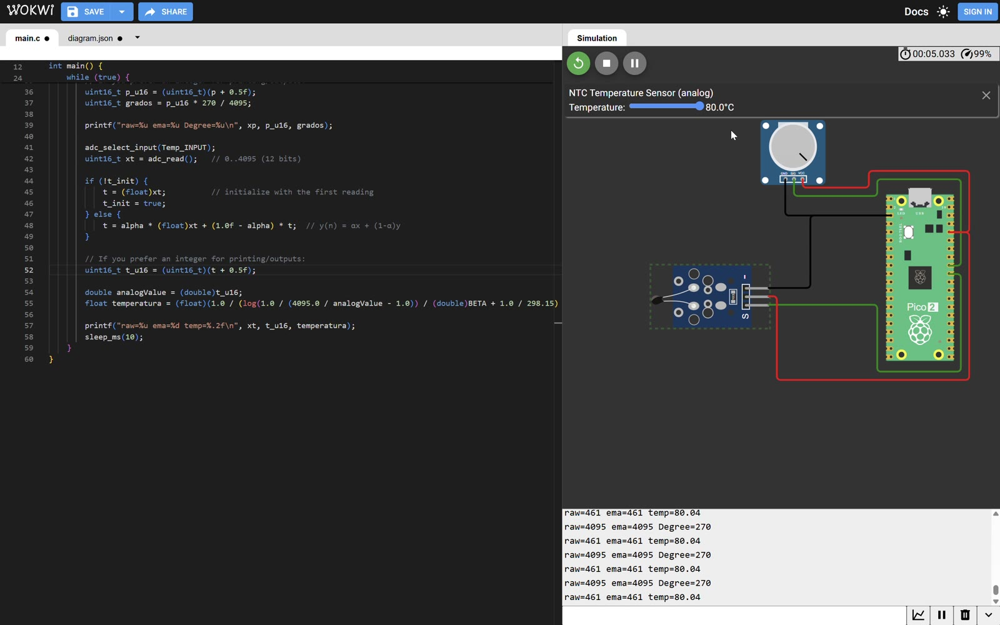

# ADC

## LDR + Electret on ADC0, Potentiometer Angle and NTC Temperature on Two Channels

**Goal (one sentence):** Use the RP2350 ADC on the Pico 2 W to read an LDR (EMA-filtered, shown in volts and as a 0–100 % light level) and an electret microphone (fixed raw threshold for "high noise") on ADC0, and then read a potentiometer (ADC1, mapped to 0–270°) and an NTC thermistor (ADC0, converted to °C with the Beta equation) in the same loop by switching the input channel.

---

## Prediction

The RP2350 ADC is 12-bit with VREF = 3.3 V, so:

- `1 LSB = 3.3 V / 4096 ≈ 0.806 mV` `V = raw · 3.3 / 4095`
- **LDR level:** `Nivel = (y − LDR_MIN) · 100 / (LDR_MAX − LDR_MIN)`, with `LDR_MIN = 9` and `LDR_MAX = 3600` taken from the darkest and brightest raw values I saw before writing the code. Covered → **≈ 0 %**; flashlight on top → **high, but < 100 %** (the flashlight was never pointed perfectly into the LDR).
- **EMA filter:** `y = α·x + (1 − α)·y` with `α = 1/16`. At one sample every 100 ms, the time constant is ≈ `Ts / α = 0.1 s · 16 = 1.6 s`, so after a sudden light change the filtered value should only reach ~63 % of the jump after ~1.6 s and ~95 % after ~4.8 s. **I expect `Filtro` to visibly lag `Raw`.**
- **Electret threshold:** the mic signal is biased around mid-scale (`3.3 V / 2 = 1.65 V ≈ 2048`). The threshold `2110` is `2110 · 3.3 / 4095 ≈ 1.70 V`, i.e. ~62 LSB (~50 mV) above the bias point, so only a reasonably loud sound should print "Ruido alto".
- **Potentiometer angle:** `grados = ema · 270 / 4095`, so each LSB is worth `270 / 4095 ≈ 0.066°`. Ends of travel → **0°** and **270°**; wiper in the middle (raw ≈ 2048) → **≈ 135°**.
- **NTC temperature:** with the Beta equation (`β = 3950`, `T0 = 25 °C = 298.15 K`) and the NTC in a divider with a resistor equal to its nominal value, 25 °C should read **raw ≈ 2048**. Since the NTC resistance drops when it heats up and it sits on the low side of the divider, I expect **hotter → lower raw value** and colder → higher raw value. The same `α = 1/16` EMA is used on both channels, so a step should need ~16 samples to reach ~63 % of the change.

## Setup

- Pin map: `LDR_GPIO_PIN` = GP26 → `LDR_ADC_INPUT` = ADC0. The same pin/channel is used for the electret (one sensor at a time, separate programs). In the pot + NTC program: GP27 → ADC1 (`Pot_INPUT`) and GP26 → ADC0 (`Temp_INPUT`).
- **LDR:** voltage divider between 3.3 V and GND, midpoint to GP26. The reading **goes up with light**, so the LDR is on the 3.3 V side and the fixed resistor on the GND side. 
- **Electret:** electret capsule with its bias resistor, a coupling capacitor and a resistor divider that centers the signal around mid-supply before GP26. 
- **Potentiometer + NTC (simulated in Wokwi):** the pot wiper goes to GP27 (ADC1) and the analog output of the NTC temperature module goes to GP26 (ADC0); both take 3.3 V and GND from the Pico 2. The temperature is changed with the sensor's slider inside the simulator. 
- Non-default: none. `adc_gpio_init()` disables the digital input buffer and pulls on each analog pin; ADC in free single-shot mode (`adc_read()`), default 150 MHz `clk_sys`. USB serial monitor at 115200 baud.

## What I did

1. Initialized the ADC (`adc_init`, `adc_gpio_init(26)`, `adc_select_input(0)`) and printed raw values to find the dark/bright extremes of the LDR → used them as `LDR_MIN = 9` and `LDR_MAX = 3600`.
2. Added the EMA filter from the course notes (`α = 0.0625`), seeded with the first sample so it doesn't start from 0.
3. Converted the filtered value to volts and to a percentage, and printed `Raw | Filtro | Voltaje | Nivel` every 100 ms.
4. Recorded a demo: hands covering the LDR, then uncovered (room light), then a phone flashlight on top and moving away → `adc_ldr_demo.mp4` (audio removed).
5. Swapped the LDR for the electret front end and flashed `adcmicrosencillo.c`, which prints the raw value every 100 ms and labels it "Ruido alto" when `raw > 2110`, otherwise "Ruido normal".
6. Built `pot_temp.c` in Wokwi to read two sensors in one loop: `adc_select_input(1)` for the pot, then `adc_select_input(0)` for the NTC, each one with its own EMA. The pot is mapped to `grados = ema · 270 / 4095` and the NTC is converted to °C with the Beta equation (`β = 3950`, `T0 = 25 °C`). The loop runs every 10 ms.
7. While recording the serial monitor, moved the NTC slider (18.8 → 80 → −24 °C) and turned the pot through its range → `adc_pot_temp_demo.mp4`.

---

## Evidence

**LDR (real board):**

| \# | File                   | What it shows                           | Reading on the serial monitor                                                          |
| --- | ---------------------- | --------------------------------------- | -------------------------------------------------------------------------------------- |
| E1 | `adc_ldr_demo.mp4` | ~0:00–0:04: LDR covered with both hands | Raw = 37, Filtro = 37, 0.03 V, Nivel = 0 %                                             |
| E2 | `adc_ldr_demo.mp4` | ~0:06: hands removed, room light        | Raw ≈ 782–787, **Filtro ≈ 488–489**, 0.39–0.40 V, Nivel = 13 % (filter still climbing) |
| E3 | `adc_ldr_demo.mp4` | ~0:09: light increasing                 | Raw = 799–1028, Filtro = 742–765, 0.60 V, Nivel = 20 %                                 |
| E4 | `adc_ldr_demo.mp4` | ~0:12: flashlight on the LDR            | **Raw = 3039 / 2906, Filtro = 2397 / 2429**, 1.93–1.96 V, Nivel = 66–67 %              |
| E5 | `adc_ldr_demo.mp4` | ~0:15: flashlight moving away           | **Raw = 1072, Filtro = 2653**, 2.14 V, Nivel = 73 % (filter still high)                |

<video controls width="100%">
  <source src="../recursos/imgs/adc_ldr_demo.mp4" type="video/mp4">
  Your browser can't play this video. <a href="../recursos/imgs/adc_ldr_demo.mp4">Download adc_ldr_demo.mp4</a>
</video>

Spot-check of the conversion with E4: `2397 · 3.3 / 4095 = 1.93 V` ✔ and `(2429 − 9) · 100 / 3591 = 67 %` ✔ — the printed values match the formulas.

**Potentiometer + NTC (Wokwi):**

| \#  | File                    | What it shows                                        | Reading on the serial monitor                                           |
| --- | ----------------------- | ---------------------------------------------------- | ----------------------------------------------------------------------- |
| E6  | `adc_pot_temp_demo.mp4` | ~0:01: NTC at the default 24 °C, pot at its maximum  | NTC raw = 2093 → **24.00 °C**; pot raw = 4095 → 270°                    |
| E7  | `adc_pot_temp_demo.mp4` | ~0:03: slider moved up to 80.0 °C                    | NTC raw = 461 → **80.04 °C**                                            |
| E8  | `adc_pot_temp_demo.mp4` | ~0:05: slider moved down to −24.0 °C                 | raw = 3813, ema = 3734 → 3744 → −19.70 / −20.20 °C (EMA not settled yet) |
| E9  | `adc_pot_temp_demo.mp4` | ~0:08: NTC settled at −24.0 °C, pot around the middle | NTC raw = 3813 → **−23.98 °C**; pot raw = 1941, ema = 1949 → 128°       |
| E10 | `adc_pot_temp_demo.mp4` | ~0:11: pot turned all the way down                   | raw = 0, ema = 368 → 345 → 323, angle = 24 → 22 → 21° (EMA going down)  |
| E11 | `adc_pot_temp_demo.mp4` | ~0:14 and ~0:17: two more pot positions              | raw = 1533 → 101°; raw = 4078 → 268°                                    |

<video controls width="100%">
  <source src="../recursos/imgs/adc_pot_temp_demo.mp4" type="video/mp4">
  Your browser can't play this video. <a href="../recursos/imgs/adc_pot_temp_demo.mp4">Download adc_pot_temp_demo.mp4</a>
</video>

Spot-check with E7: `4095 / 461 − 1 = 7.883`, `ln(1 / 7.883) = −2.065`, `1 / (−2.065 / 3950 + 1 / 298.15) = 353.19 K = 80.04 °C` ✔. For the pot, E11 gives `1533 · 270 / 4095 = 101.1 → 101°` ✔. Once the EMA settles the NTC reading stays within ~0.05 °C of the slider (E6, E7, E9), and the raw value drops when the temperature goes up (E7 vs E8), which confirms the prediction that the NTC is on the low side of the divider. In E10 each new EMA value is `368 · 15/16 = 345` and `345 · 15/16 = 323`, exactly the `α = 1/16` decay.

## What went wrong

- **Wiring error on the temperature sensor:** the temperature sensor was connected wrong the first time, so it didn't give a valid reading and we had to check the wiring again before it worked.
- **No instrumented electret, so only a simple noise detector:** we didn't buy the electret module with its own amplifier, so we only had the bare capsule with a basic bias/divider front end. Its signal is small, so instead of actually measuring sound level we built a simple noise detector: one raw sample compared against a fixed threshold (`2110`, ≈ 1.70 V) that prints "Ruido alto" / "Ruido normal".
- **Calibrating the potentiometer reading took some effort:** it took several attempts to make the pot reading cover its whole range, until the raw values 0–4095 lined up with the real ends of the potentiometer (0° and 270°).

## Code

**Shared setup code** (same ADC initialization in the three programs — only the channels and the loop body change):

```c
#include "pico/stdlib.h"
#include "hardware/adc.h"
#include <math.h>        // log() for the NTC Beta equation

#define LDR_GPIO_PIN   26   // GP26 -> ADC0 (LDR / electret / NTC)
#define LDR_ADC_INPUT  0
#define Temp_INPUT     0    // ADC0 -> GP26
#define Pot_INPUT      1    // ADC1 -> GP27
#define LDR_MIN        9
#define LDR_MAX        3600
#define BETA           3950.0

const float alpha = 0.0625f;   // EMA weight = 1/16

stdio_init_all();
adc_init();
adc_gpio_init(26);             // analog mode on GP26 (no digital buffer, no pulls)
adc_gpio_init(27);             // only in pot_temp.c
adc_select_input(LDR_ADC_INPUT);
```

**LDR — EMA filter + conversion (`Fotorresistencia.c`)**

```c
uint16_t x = adc_read();                       // 0..4095
if (!y_init) { y = (float)x; y_init = true; }  // first sample seeds the filter
else          y = alpha * (float)x + (1.0f - alpha) * y;   // alpha = 1/16

uint16_t y_u16 = (uint16_t)(y + 0.5f);         // round the filtered value
float voltaje  = (y_u16 * 3.3f) / 4095.0f;
int porcentaje = ((y_u16 - LDR_MIN) * 100) / (LDR_MAX - LDR_MIN);
```

**Electret — fixed threshold (`adcmicrosencillo.c`)**

```c
uint16_t m = adc_read();
if (m > 2110) printf("Raw=%u | Ruido alto\n", m);    // ~1.70 V, ~62 LSB above mid-scale
else          printf("Raw=%u | Ruido normal\n", m);
sleep_ms(100);
```

**Potentiometer + NTC — two channels in one loop (`pot_temp.c`)**

```c
// Channel 1: potentiometer (GP27 -> ADC1)
adc_select_input(Pot_INPUT);
uint16_t xp = adc_read();
p = alpha * (float)xp + (1.0f - alpha) * p;          // EMA of the pot
uint16_t grados = (uint16_t)(p + 0.5f) * 270 / 4095;  // 0..270 degrees

// Channel 0: NTC thermistor (GP26 -> ADC0)
adc_select_input(Temp_INPUT);
uint16_t xt = adc_read();
t = alpha * (float)xt + (1.0f - alpha) * t;          // EMA of the NTC
double a = (double)(uint16_t)(t + 0.5f);
float temperatura = (float)(1.0 / (log(1.0 / (4095.0 / a - 1.0)) / BETA
                    + 1.0 / 298.15) - 273.15);       // Beta equation, T0 = 25 °C -> °C
```

## Open question

The microphone code compares a single raw sample against `NOISE_THRESHOLD = 2110`. Would the peak-to-peak value or the RMS over a window of samples classify the noise more reliably than one sample?