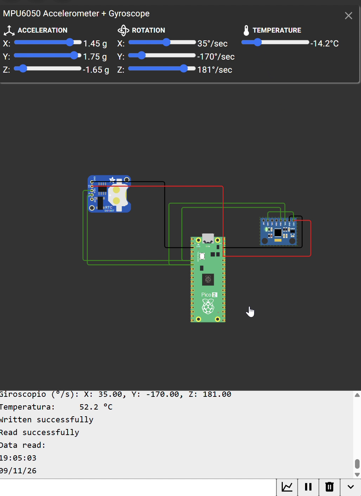

# I2C

## DS1307 RTC and MPU6050 Sharing One Bus (Wokwi)

**Goal (one sentence):** Use `i2c0` on the Pico 2 as the only master of a bus shared by two slaves — a DS1307 real-time clock (time and date) and an MPU6050 (acceleration, angular rate and temperature) — reading each one with a register-pointer write followed by a repeated START and a read, and printing the values over USB serial.

---

## Prediction

- **Addresses:** the DS1307 has a fixed 7-bit address `0x68`, and the MPU6050 also answers at `0x68` when AD0 is low. With both on the same SDA/SCL the replies would collide, so I expect to need **AD0 = 1 → MPU6050 at `0x69`**.
- **DS1307:** registers `0x00…0x06` hold seconds, minutes, hours, day of week, date, month and year in **BCD**, so printing each byte with `%02x` should already show the decimal digits (e.g. `0x59` → "59"). With one print every 2 s, the seconds should advance in steps of 2 and roll over correctly into the next minute.
- **MPU6050:** a single 14-byte burst from `0x3B` returns `ax, ay, az, temp, gx, gy, gz` as big-endian signed 16-bit values. With the default ranges:
    - acceleration: `a = raw / 16384` g (±2 g)
    - angular rate: `ω = raw / 131` °/s (±250 °/s)
    - temperature: `T = raw / 340 + 36.53` °C
- Negative readings should come out negative only if each pair of bytes is cast to `int16_t` **before** converting; otherwise they would wrap to large positive numbers.

## Setup

- Pin map: SDA = GP4, SCL = GP5 (`i2c0`), shared by both modules. DS1307 → `0x68`; MPU6050 → `0x69` (AD0 tied to 3V3).
- Both modules powered from the Pico's 3V3 and GND.
- Simulated in Wokwi: 
- Non-default: none on the Pico side. Bus at 100 kHz (standard mode, the DS1307's maximum) with the RP2350 internal pull-ups instead of external resistors; MPU6050 left at its default ±2 g / ±250 °/s ranges; default 150 MHz `clk_sys`.

## What I did

1. Connected SDA and SCL of both modules to GP4 and GP5 and tied the MPU6050's AD0 to 3V3 to move it to `0x69`.
2. Initialized `i2c0` at 100 kHz, set GP4/GP5 to `GPIO_FUNC_I2C` and enabled their pull-ups.
3. RTC: wrote the register pointer `0x00` with `nostop = true` (repeated START), read 7 bytes and printed time and date in hex, since the registers are already BCD.
4. MPU6050: same sequence from register `0x3B`, read 14 bytes, joined each high/low pair into an `int16_t` and converted it to g, °/s and °C.
5. Ran the simulation, moved the MPU6050 sliders in Wokwi while the serial monitor was printing, and recorded it → `i2c_wokwi_demo.mp4` (audio removed).

---

## Evidence

| \# | File | What it shows | Reading on the serial monitor |
| --- | --- | --- | --- |
| E1 | `i2c_wokwi_demo.mp4` | RTC output, one line every 2 s | **19:04:59 → 19:05:01 → 19:05:03 → 19:05:05**, date 09/11/26 |
| E2 | `i2c_wokwi_demo.mp4` | First MPU6050 readings | ay = **−1.40 g**, gy = 152 °/s, gz = 19 °/s, T = **52.2 °C** |
| E3 | `i2c_wokwi_demo.mp4` | MPU6050 after moving the sliders | ay = 1.75 g, az = **−1.65 g**, gy = **−170 °/s**, gz = 181 °/s, T = **−14.2 °C** |

<video controls width="100%">
  <source src="../recursos/imgs/i2c_wokwi_demo.mp4" type="video/mp4">
  Your browser can't play this video. <a href="../recursos/imgs/i2c_wokwi_demo.mp4">Download i2c_wokwi_demo.mp4</a>
</video>

Spot-check, working the formulas backwards to the raw register values: `52.2 °C → (52.2 − 36.53) · 340 ≈ 5328` and `−14.2 °C → (−14.2 − 36.53) · 340 ≈ −17248`; `−1.40 g → −1.40 · 16384 ≈ −22938`; `−170 °/s → −170 · 131 = −22270`. All of them fit inside a signed 16-bit range (±32767), and the negative ones only print as negative because of the `int16_t` cast ✔. The seconds in E1 move by exactly 2 per line and roll from 59 to 01 into the next minute ✔, and every line of E2/E3 shows both devices still answering on the shared bus.

## What went wrong

- **Two slaves at the same address:** with AD0 left low, the MPU6050 also sat at `0x68`, the same as the DS1307, so we couldn't tell which device was answering. Tying AD0 to 3V3 moved the MPU6050 to `0x69` and fixed it.
- **Wrong return codes in the MPU error message:** the MPU6050 error check was copied from the RTC block and was still printing the RTC's return values. We changed it to use the MPU's own `i2c_write_blocking` / `i2c_read_blocking` results. It never showed up in the demo because in Wokwi both devices always acknowledged.

## Code

**Shared setup code** (bus and addresses — both devices are read with the same pointer-write + repeated-START pattern):

```c
#define I2C_PORT     i2c0
#define SDA_PIN      4
#define SCL_PIN      5
#define DS1307_ADDR  0x68
#define MPU_ADDR     0x69          // AD0 = 3V3 (0x68 would collide with the DS1307)

i2c_init(I2C_PORT, 100 * 1000);    // 100 kHz, standard mode
gpio_set_function(SDA_PIN, GPIO_FUNC_I2C);
gpio_set_function(SCL_PIN, GPIO_FUNC_I2C);
gpio_pull_up(SDA_PIN);             // internal pull-ups instead of external resistors
gpio_pull_up(SCL_PIN);
```

**DS1307 — 7 BCD registers from `0x00`**

```c
uint8_t reg = 0x00, rtc[7];
i2c_write_blocking(I2C_PORT, DS1307_ADDR, &reg, 1, true);       // pointer -> 0x00, keep the bus (repeated START)
int r_rtc = i2c_read_blocking(I2C_PORT, DS1307_ADDR, rtc, 7, false);

if (r_rtc == 7)                                                  // BCD printed in hex = decimal digits
    printf("RTC %02x:%02x:%02x  %02x/%02x/%02x\n",
           rtc[2], rtc[1], rtc[0] & 0x7F, rtc[4], rtc[5], rtc[6]);
```

**MPU6050 — 14-byte burst from `0x3B`**

```c
uint8_t mreg = 0x3B, d[14];
int w_mpu = i2c_write_blocking(I2C_PORT, MPU_ADDR, &mreg, 1, true);
int r_mpu = i2c_read_blocking(I2C_PORT, MPU_ADDR, d, 14, false);
if (w_mpu < 0 || r_mpu < 0) printf("MPU error: w=%d r=%d\n", w_mpu, r_mpu);   // MPU's own codes

int16_t ay   = (int16_t)(d[2]  << 8 | d[3]);    // cast keeps the sign
int16_t az   = (int16_t)(d[4]  << 8 | d[5]);
int16_t temp = (int16_t)(d[6]  << 8 | d[7]);
int16_t gy   = (int16_t)(d[10] << 8 | d[11]);

float ay_g  = ay / 16384.0f;                    // ±2 g
float az_g  = az / 16384.0f;
float t_c   = temp / 340.0f + 36.53f;           // datasheet formula
float gy_ds = gy / 131.0f;                      // ±250 °/s

sleep_ms(2000);
```

## Open question

On a physical MPU6050 the chip starts in sleep mode, so does it return all zeros from `0x3B` unless `0x00` is written to `PWR_MGMT_1` (`0x6B`) first, even though Wokwi gave valid data without it? And does a brand-new DS1307 come with the clock-halt bit (bit 7 of the seconds register) set, so the time doesn't advance until it is cleared?
